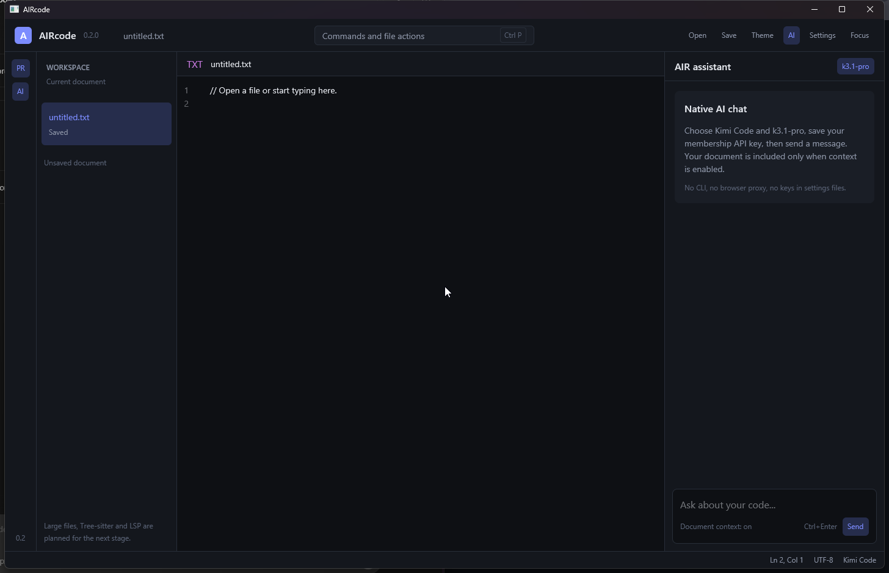

# AIRcode

**A lightweight native code editor and AI workspace written in Rust.**
**Лёгкий нативный редактор кода и ИИ-рабочее пространство на Rust.**

[English](#english) · [Русский](#русский)



## English

AIRcode combines a native GPUI editor, a project explorer, Tree-sitter syntax highlighting, and direct streaming AI integrations. Version **0.3.0** is a working Windows x86_64 portable release.

No Electron, embedded browser, CLI agent, or protocol-translating proxy is used. API keys stay in the operating system's credential store.

### Download Windows

Download `aircode-windows-x86_64.zip` from the [latest GitHub Release](https://github.com/device-vv/aircode/releases/latest), extract it, and run `aircode.exe`. Rust and Cargo are not required.

The executable is portable and currently **unsigned**, so Windows SmartScreen may ask for confirmation. Verify the SHA256 file published beside the package.

### Implemented in v0.3.0

- Open a complete project folder with a lazy file tree and filesystem change watching.
- Open, edit, and save UTF-8 files, with Unicode selection, Windows IME input, clipboard, undo/redo, and unsaved-change confirmation.
- Incremental Tree-sitter highlighting for Rust, Python, JavaScript, TypeScript, Go, C, C++, Java, C#, HTML, CSS, JSON, TOML, YAML, and Markdown. Only visible lines are rendered.
- Project, editor, and agent panels with draggable splitters and saved widths.
- Custom AIRcode title bar and application icon; working minimize, maximize/restore, and close controls. No console window on Windows.
- Non-blocking file/folder dialogs and title-bar dragging across monitors, with repeated Windows window-state stress validation.
- English and Russian interfaces. English is the default; Russian-system users are offered a one-time language switch.
- Streaming AI chat with collapsible reasoning, cancellation, message copying, and context menus for cut/copy/paste/select all.
- Optional document or selection context, limited to 200 KB per request.
- Project agent tools: list, read, search, write, create directories, move, delete, and run commands. The agent is limited to eight tool steps per session.
- Three permission modes: **Ask every action**, **Ask important only**, and **Full access**. Approval includes the tool arguments and a diff for file writes. An activity log records tool calls and results.
- Light and dark themes, native Kimi Code support, and custom OpenAI-compatible providers.

Not included yet: LSP, debugging/DAP, Git operations, an integrated terminal, multi-tab editing, and signed installers. Files larger than 16 MiB are rejected. macOS and Linux remain compile targets, not published or runtime-validated releases.

### Agent permissions and safety

- **Ask every action** requires approval for every tool, including read-only operations.
- **Ask important only** allows list/read/search but asks before writes, deletes, moves, directory creation, and commands.
- **Full access** executes all tools without confirmation. Use it only for a project and provider you trust.

File tools are restricted to the opened project. They reject parent-directory escapes and protected paths such as `.git`, `.env*`, `*.pem`, `*.key`, and credential files. Existing symlinks are not followed by listing and search.

**Shell commands are not sandboxed.** They run with your user permissions in the project root and can access anything available to that user, including protected paths. Commands have a 30-second timeout and can be stopped; stopping a command is not a substitute for a process-isolation sandbox.

A project can also be opened at startup:

```powershell
aircode.exe --project "C:\path\to\project"
```

### Native Kimi integration

AIRcode uses the official Kimi Code Chat Completions API directly:

- China: `https://api.kimi.com/coding/v1`
- Overseas: `https://api.kimi.ai/coding/v1`

Available model IDs:

- `k3.1-pro`
- `k3.1-pro-highspeed`
- `k3`
- `k3-256k`
- `kimi-for-coding`
- `kimi-for-coding-highspeed`

K3.1 Pro always uses thinking. `low`, `high`, and `max` reasoning effort levels are available; `high` is the default. Changing the model or effort starts a new session. Model availability and context limits depend on the membership tier.

Setup:

1. Create a membership API key in the Kimi Code Console.
2. Open **Settings** in AIRcode.
3. Select **Kimi Code**, your region, and `k3.1-pro`.
4. Paste the key and choose **Save key**.
5. Close Settings, write a message, and choose **Send** or press `Ctrl/Cmd + Enter`.

A separate **Kimi Platform** profile supports the official Moonshot China and overseas endpoints with a manually entered model ID. Coding Plan model IDs are not silently applied to Platform accounts.

Official references: [Kimi Code overview](https://www.kimi.com/code/docs/en/) and [model configuration](https://www.kimi.com/code/docs/en/kimi-code/models.html).

### Other providers

- **DeepSeek** with the official preset.
- **RouterAI** with `https://routerai.ru/api/v1` and `provider/model` IDs.
- **OpenAI-compatible** services with a custom `base_url` and model ID.

The integration uses native HTTP/SSE with an `AIRcode/<version>` User-Agent. Provider and tool-call contract tests use local mock servers. Live access depends on your account and key; a real paid provider account was not used for release validation.

### Security

- API keys are saved in Windows Credential Manager or the equivalent OS backend.
- Settings contain only provider, interface, panel, permission, and context preferences.
- Keys are excluded from logs, errors, Git, and release archives.
- Nothing is sent to a provider until you explicitly send a message.
- Document context can be disabled in Settings.

### Build from source

Requires Rust 1.90 or newer and the platform dependencies of GPUI.

```bash
git clone https://github.com/device-vv/aircode.git
cd aircode
cargo run -p aircode-app
```

Validation:

```bash
cargo fmt --all -- --check
cargo test --workspace
cargo clippy --workspace --all-targets -- -D warnings
cargo build --release --target x86_64-pc-windows-msvc
```

### Keyboard shortcuts

Use `Ctrl` on Windows/Linux and `Cmd` on macOS.

| Action | Shortcut |
| --- | --- |
| Open file | `Ctrl/Cmd + O` |
| Save file | `Ctrl/Cmd + S` |
| Save file as | `Ctrl/Cmd + Shift + S` |
| Command palette | `Ctrl/Cmd + P` |
| Send chat message | `Ctrl/Cmd + Enter` |
| New chat | `Ctrl/Cmd + Shift + N` |
| Toggle AI panel | `Ctrl/Cmd + Shift + I` |
| Focus mode | `Ctrl/Cmd + Shift + F` |
| Light/dark theme | `Ctrl/Cmd + Shift + T` |
| Provider settings | `Ctrl/Cmd + ,` |
| Close overlay | `Esc` |

### Project structure

```text
crates/aircode-agent     Permission modes, sandboxed file tools, commands
crates/aircode-ai        Providers, credentials, settings, HTTP and SSE
crates/aircode-app       aircode.exe entry point and Windows resources
crates/aircode-core      Workspace state
crates/aircode-editor    Unicode document, file I/O, undo/redo
crates/aircode-i18n      English/Russian translations and locale detection
crates/aircode-project   Lazy project tree and filesystem watcher
crates/aircode-syntax    Incremental Tree-sitter parsing and highlights
crates/aircode-ui        GPUI editor, panels, chat and settings
.github/workflows        CI and Windows releases
```

### License

Apache-2.0. See [LICENSE](LICENSE).

---

## Русский

AIRcode объединяет нативный GPUI-редактор, дерево проекта, подсветку Tree-sitter и прямые потоковые ИИ-интеграции. Версия **0.3.0** — рабочий portable-релиз для Windows x86_64.

Без Electron, встроенного браузера, CLI-агентов и прокси для преобразования протоколов. API-ключи хранятся в системном хранилище ОС.

### Скачать для Windows

Скачайте `aircode-windows-x86_64.zip` из [последнего GitHub Release](https://github.com/device-vv/aircode/releases/latest), распакуйте и запустите `aircode.exe`. Rust и Cargo не требуются.

Приложение portable и пока **не имеет цифровой подписи**, поэтому Windows SmartScreen может запросить подтверждение. Проверьте SHA256-файл рядом с пакетом.

### Реализовано в v0.3.0

- Открытие всей папки проекта, ленивое дерево файлов и отслеживание изменений на диске.
- Открытие, редактирование и сохранение UTF-8 файлов, Unicode-выделение, Windows IME, буфер обмена, undo/redo и подтверждение при потере изменений.
- Инкрементальная подсветка Tree-sitter для Rust, Python, JavaScript, TypeScript, Go, C, C++, Java, C#, HTML, CSS, JSON, TOML, YAML и Markdown. Отрисовываются только видимые строки.
- Панели проекта, редактора и агента с изменяемой шириной и сохранением размеров.
- Фирменная строка заголовка и иконка, рабочие сворачивание, разворачивание/восстановление и закрытие. Консоль Windows не открывается.
- Неблокирующие диалоги файлов/папок и перетаскивание окна между мониторами; повторные стресс-проверки состояния окна Windows.
- Английский и русский интерфейсы. По умолчанию английский; при русской системе предлагается однократное переключение.
- Потоковый чат, сворачиваемые рассуждения, остановка, копирование сообщений и контекстное меню вырезания/копирования/вставки/выделения.
- Контекст документа или выделения по выбору пользователя, до 200 КБ на запрос.
- Инструменты агента: список, чтение, поиск, запись, создание папок, перемещение, удаление и команды. Не более восьми шагов за сессию.
- Три режима: **Спрашивать каждое действие**, **Спрашивать только важное**, **Полный доступ**. Перед записью показываются аргументы и diff. Журнал содержит вызовы и результаты.
- Светлая и тёмная темы, нативный Kimi Code и пользовательские OpenAI-совместимые провайдеры.

Пока не входят: LSP, отладка/DAP, Git, встроенный терминал, несколько вкладок и подписанные установщики. Файлы больше 16 МиБ отклоняются. macOS и Linux остаются целями компиляции, но не опубликованными и не проверенными в работе релизами.

### Разрешения и безопасность агента

- **Спрашивать каждое действие** требует подтверждения всех инструментов, включая чтение.
- **Спрашивать только важное** разрешает список/чтение/поиск, но спрашивает перед записью, удалением, перемещением, созданием папок и командами.
- **Полный доступ** выполняет всё без подтверждения. Используйте его только для доверенных проекта и провайдера.

Файловые инструменты ограничены открытым проектом и запрещают выход через `..`, а также `.git`, `.env*`, `*.pem`, `*.key` и credential-файлы. Список и поиск не переходят по существующим символическим ссылкам.

**Shell-команды не изолированы.** Они работают с правами пользователя в корне проекта и могут обращаться ко всем доступным ему данным, включая защищённые пути. Тайм-аут — 30 секунд, выполнение можно остановить; остановка не заменяет изоляцию процессов.

Папку можно открыть при запуске:

```powershell
aircode.exe --project "C:\path\to\project"
```

### Нативная интеграция Kimi

AIRcode напрямую использует официальный Kimi Code Chat Completions API:

- Китай: `https://api.kimi.com/coding/v1`
- Другие регионы: `https://api.kimi.ai/coding/v1`

Доступные идентификаторы моделей:

- `k3.1-pro`
- `k3.1-pro-highspeed`
- `k3`
- `k3-256k`
- `kimi-for-coding`
- `kimi-for-coding-highspeed`

K3.1 Pro всегда использует thinking. Доступны `low`, `high` и `max`, по умолчанию — `high`. Смена модели или effort начинает новую сессию. Доступность моделей и лимит контекста зависят от подписки.

Настройка:

1. Создайте membership API key в Kimi Code Console.
2. Откройте **Настройки** в AIRcode.
3. Выберите **Kimi Code**, регион и `k3.1-pro`.
4. Вставьте ключ и нажмите **Сохранить ключ**.
5. Закройте настройки, напишите сообщение и нажмите **Отправить** или `Ctrl/Cmd + Enter`.

Отдельный профиль **Kimi Platform** поддерживает официальные Moonshot endpoint'ы с ручным вводом model ID. Идентификаторы Coding Plan автоматически не применяются к Platform.

Официальные источники: [обзор Kimi Code](https://www.kimi.com/code/docs/en/) и [настройка моделей](https://www.kimi.com/code/docs/en/kimi-code/models.html).

### Другие провайдеры

- **DeepSeek** с официальным preset.
- **RouterAI** с `https://routerai.ru/api/v1` и идентификаторами `provider/model`.
- **OpenAI-совместимые** сервисы с пользовательскими `base_url` и model ID.

Используется нативный HTTP/SSE и `AIRcode/<version>` User-Agent. Контрактные тесты работают с локальными mock-серверами. Доступ зависит от аккаунта и ключа; реальный платный аккаунт для проверки релиза не использовался.

### Безопасность

- API-ключи сохраняются в Windows Credential Manager или эквивалентном backend ОС.
- В настройках находятся только провайдер, интерфейс, панели, разрешения и контекст.
- Ключи не попадают в логи, ошибки, Git и архивы релиза.
- Ничего не отправляется провайдеру без явной отправки сообщения.
- Контекст документа можно отключить в настройках.

### Сборка из исходников

Требуется Rust 1.90 или новее и системные зависимости GPUI.

```bash
git clone https://github.com/device-vv/aircode.git
cd aircode
cargo run -p aircode-app
```

Проверка:

```bash
cargo fmt --all -- --check
cargo test --workspace
cargo clippy --workspace --all-targets -- -D warnings
cargo build --release --target x86_64-pc-windows-msvc
```

### Горячие клавиши

Используйте `Ctrl` в Windows/Linux и `Cmd` в macOS.

| Действие | Сочетание |
| --- | --- |
| Открыть файл | `Ctrl/Cmd + O` |
| Сохранить файл | `Ctrl/Cmd + S` |
| Сохранить как | `Ctrl/Cmd + Shift + S` |
| Палитра команд | `Ctrl/Cmd + P` |
| Отправить сообщение | `Ctrl/Cmd + Enter` |
| Новый чат | `Ctrl/Cmd + Shift + N` |
| Панель ИИ | `Ctrl/Cmd + Shift + I` |
| Режим фокуса | `Ctrl/Cmd + Shift + F` |
| Тема | `Ctrl/Cmd + Shift + T` |
| Настройки провайдера | `Ctrl/Cmd + ,` |
| Закрыть панель | `Esc` |

### Структура проекта

```text
crates/aircode-agent     Разрешения, файловые инструменты, команды
crates/aircode-ai        Провайдеры, ключи, настройки, HTTP и SSE
crates/aircode-app       Точка входа и ресурсы Windows
crates/aircode-core      Состояние рабочего пространства
crates/aircode-editor    Unicode-документ, файлы, undo/redo
crates/aircode-i18n      Английский/русский и определение локали
crates/aircode-project   Дерево проекта и отслеживание изменений
crates/aircode-syntax    Инкрементальный Tree-sitter и подсветка
crates/aircode-ui        GPUI-редактор, панели, чат и настройки
.github/workflows        CI и Windows-релизы
```

### Лицензия

Apache-2.0. См. [LICENSE](LICENSE).
